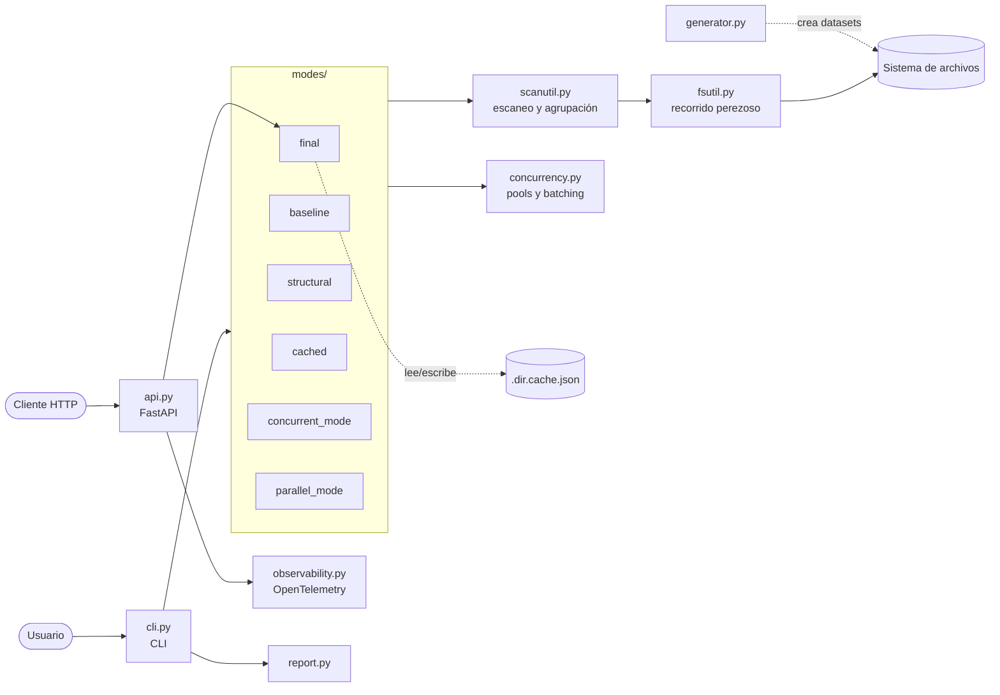

# Arquitectura

## Diagrama de componentes

## Módulos y responsabilidades

| Módulo | Responsabilidad | Depende de |
|---|---|---|
| `cli.py` | Parsear argumentos, elegir el modo, perfilar con `--profile` | `modes/*`, `report` |
| `api.py` | Exponer el modo `final` como API REST (`/health`, `/scan`) | FastAPI, `modes/final`, `modes/cached`, `observability` |
| `observability.py` | Configurar el tracer de OpenTelemetry (exporta a consola) | opentelemetry-sdk |
| `modes/baseline.py` | Fuerza bruta: compara pares byte a byte | `scanutil` |
| `modes/structural.py` | Prefiltro por tamaño + SHA-256 incremental (`hash_file`) | `scanutil` |
| `modes/cached.py` | Cache de hashes por `(path, size, mtime)` en JSON | `structural`, `scanutil` |
| `modes/concurrent_mode.py` | Hashear con `ThreadPoolExecutor` | `concurrency` |
| `modes/parallel_mode.py` | Hashear con `ProcessPoolExecutor` | `concurrency` |
| `modes/final.py` | Integra prefiltro, cache y ruteo threads/procesos por tamaño | `cached`, `concurrency`, `scanutil` |
| `scanutil.py` | Código común: listar, `stat`, agrupar por tamaño, clave de cache | `fsutil` |
| `concurrency.py` | Pools sobre cola de trabajos, con batching opcional | stdlib |
| `fsutil.py` | Generador que recorre el árbol con `os.walk` | stdlib |
| `report.py` | Imprimir el resultado de un escaneo | stdlib |
| `generator.py` | Crear datasets sintéticos reproducibles | stdlib |

## Dependencias externas

| Paquete | Uso | Tipo |
|---|---|---|
| fastapi, uvicorn | Servicio REST | Ejecución |
| opentelemetry-* | Trazas del servicio | Ejecución |
| pytest, pytest-cov, pytest-benchmark, httpx | Pruebas, cobertura y benchmarks | Desarrollo |
| ruff, pylint, mypy, radon, xenon | Calidad estática | Desarrollo |
| bandit, pip-audit | Seguridad | Desarrollo |
| mkdocs-material, sphinx, furo | Documentación | Desarrollo |
| scalene, memory_profiler | Profiling manual (Parcial 2) | Desarrollo |

Las versiones exactas están en `requirements.txt` (ejecución) y
`requirements-dev.txt` (desarrollo + CI).
