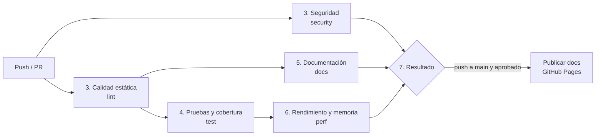

# Integración continua

Plataforma: **GitHub Actions**. Archivos:

- `.github/workflows/ci.yml`: pipeline principal.
- `.github/workflows/codeql.yml`: análisis de seguridad con CodeQL.
- `.github/dependabot.yml`: actualización automática de dependencias.

Se ejecuta en cada push y cada pull request hacia `main` (y a mano desde la
pestaña *Actions*). Los comandos de cada control no están escritos en el YAML:
cada job llama a `python scripts/checks.py <etapa>`, el mismo comando que se usa en
local (ver [Mantenimiento](mantenimiento.md)).

## Etapas

| # | Etapa | Job | Contenido | Tiempo aprox. |
|---|---|---|---|---|
| 1 | Integración del código | — | Push o pull request; revisión del PR | — |
| 2 | Preparación del entorno | todos | Python 3.12, `pip install -r requirements-dev.txt` (versiones fijadas, cache de pip) | 30 s |
| 3 | Calidad estática | `lint`, `security` | Ruff, Pylint, mypy, Radon, Xenon / Bandit, pip-audit, Gitleaks | 1 min |
| 4 | Pruebas y cobertura | `test` | pytest + coverage con umbral | 1 min |
| 5 | Documentación | `docs` | MkDocs estricto, Sphinx `-W`, Lychee | 1 min |
| 6 | Rendimiento y memoria | `perf` | pytest-benchmark (vs `main`), tracemalloc, cProfile | 1–2 min |
| 7 | Resultado final | `resultado` | Aprobado / Rechazado, resumen y artefactos | segundos |

`lint` y `security` arrancan en paralelo porque no dependen entre sí. `test` y
`docs` esperan a `lint`: si el código ni siquiera pasa el análisis estático, no se
gastan minutos en lo demás. `perf` espera a `test` porque medir código con pruebas
fallidas no tiene sentido. `resultado` es el **único check requerido** por la regla
de protección de `main`: resume todos los anteriores.

## Matriz de controles

| Control | Herramienta | Comando (en `scripts/checks.py`) | Reporte | Rechaza si |
|---|---|---|---|---|
| Pruebas | pytest | `pytest` | `junit.xml` | Falla una o más pruebas |
| Cobertura | coverage.py (pytest-cov) | `--cov-fail-under=95` | `coverage.xml`, `htmlcov/` | Cobertura < 95% |
| Análisis estático | Ruff | `ruff check .` y `ruff format --check .` | Salida del job | Cualquier error o archivo sin formato |
| Análisis estático | Pylint | `pylint src/dupfinder --fail-under=9.5` | Salida del job | Puntaje < 9.5 |
| Tipado | mypy | `mypy src` | Salida del job | Cualquier error de tipos |
| Complejidad | Radon + Xenon | `radon cc -s -a` (reporte) y `xenon --max-absolute B --max-modules B --max-average A` | `radon-cc.txt` | Una función con complejidad C o mayor (> 10), un módulo con promedio C o mayor, o promedio general peor que A |
| Vulnerabilidades en código | Bandit | `bandit -r src --severity-level medium --confidence-level medium` | `bandit.txt`, `bandit.sarif` | Severidad media o alta |
| Vulnerabilidades en código | CodeQL | `codeql.yml` (`security-extended`) | Pestaña *Security* | Alerta alta o crítica |
| Dependencias | pip-audit | `pip-audit -r requirements-dev.txt` | `pip-audit.json` | Vulnerabilidad conocida sin excepción |
| Dependencias | Dependabot | `dependabot.yml` | PRs y alertas | No bloquea (sus PRs pasan por este CI) |
| Secretos | Gitleaks | `gitleaks git` (historial completo) | `gitleaks.sarif` | Cualquier secreto |
| Documentación | MkDocs | `mkdocs build --strict` | Sitio (`site/`) | Error o advertencia (página o enlace interno roto) |
| Documentación | Sphinx | `sphinx -W -b html docs` | HTML | Cualquier advertencia |
| Documentación | Lychee | `lychee manual README.md` | `lychee.md` | Enlace externo roto |
| Benchmark | pytest-benchmark | `pytest benchmarks --benchmark-compare-fail=median:30%` | `benchmark.json` | Mediana más de 30% peor que `main` (solo en PR) |
| Memoria | tracemalloc | `benchmarks/test_memory.py` | Salida del job | Pico mayor al límite medido |
| Profiling de CPU | cProfile | `cProfile -m dupfinder.cli --modo estructura` | `profile.txt`, `profile.prof` | No bloquea (informativo) |

Los umbrales están definidos al principio de `scripts/checks.py`; el motivo de cada
uno está en [Mantenimiento](mantenimiento.md#umbrales).

## Qué pasa si un control falla

| Tipo de control | Comportamiento |
|---|---|
| Deterministas (pruebas, lint, tipos, complejidad, seguridad, docs) | Un fallo rechaza el pipeline sin reintentos: el mismo código da el mismo resultado. |
| Benchmarks | Se repiten muchas rondas y se compara la mediana contra `main` en la misma máquina, con tolerancia del 30%. En un push a `main` solo se registran (no hay contra qué comparar). |
| Memoria | Límite fijo sobre tracemalloc, que no depende de la máquina, con margen sobre lo medido. |
| Profiling | Solo genera el reporte. |
| Informativos (`radon (reporte)`, `bandit (reporte)`) | Se marcan como AVISO en el resumen sin rechazar. |

Al terminar, cada job agrega una tabla al resumen de la ejecución (pestaña
*Summary*) y sube sus reportes como artefactos (`reportes-lint`,
`reportes-seguridad`, `reportes-pruebas`, `reportes-docs`, `reportes-rendimiento`).

## Seguridad del propio pipeline

- Permisos mínimos: `contents: read` por defecto; solo `security` puede escribir
  alertas y solo `publicar-docs` puede publicar en Pages.
- Gitleaks y Lychee se descargan en una versión fija y se verifica su checksum.
- Dependabot mantiene actualizadas también las versiones de las Actions.
